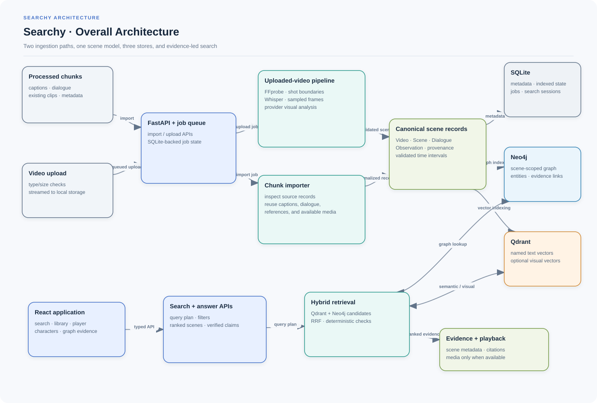
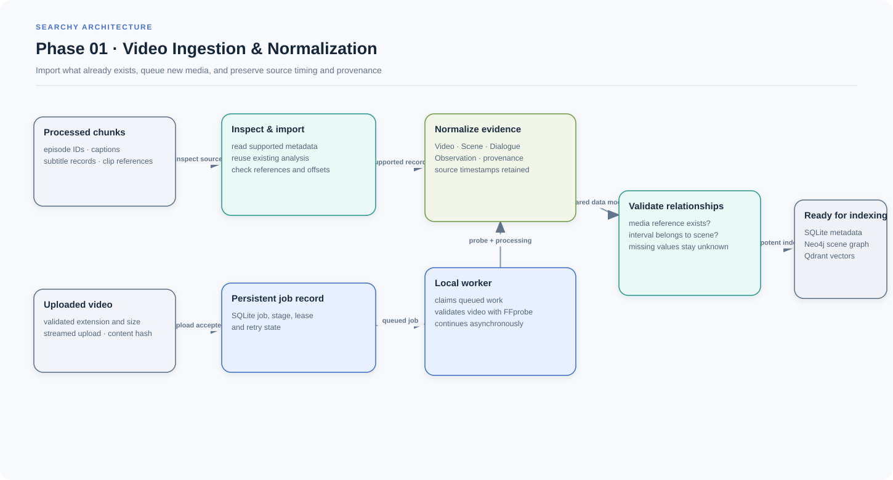
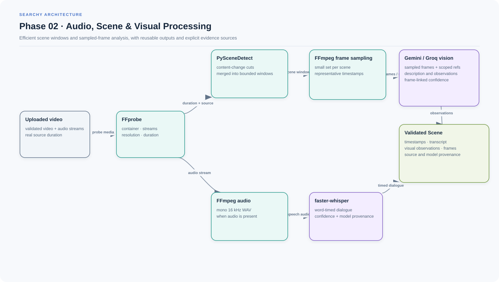
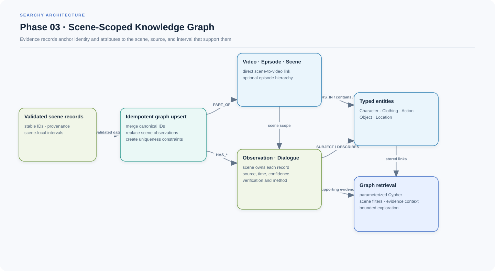
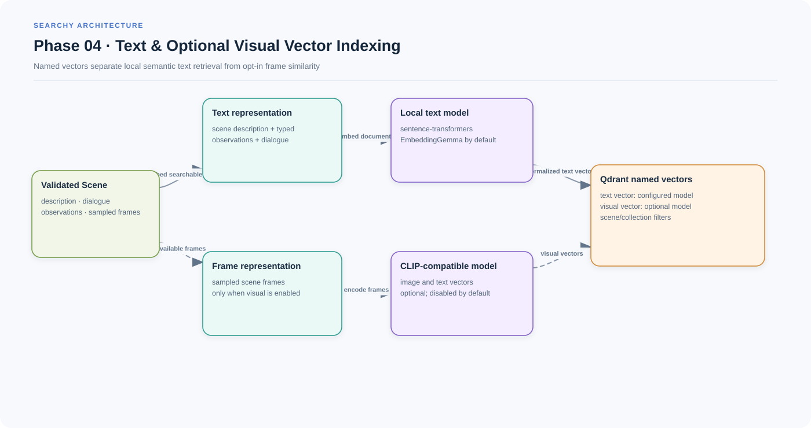
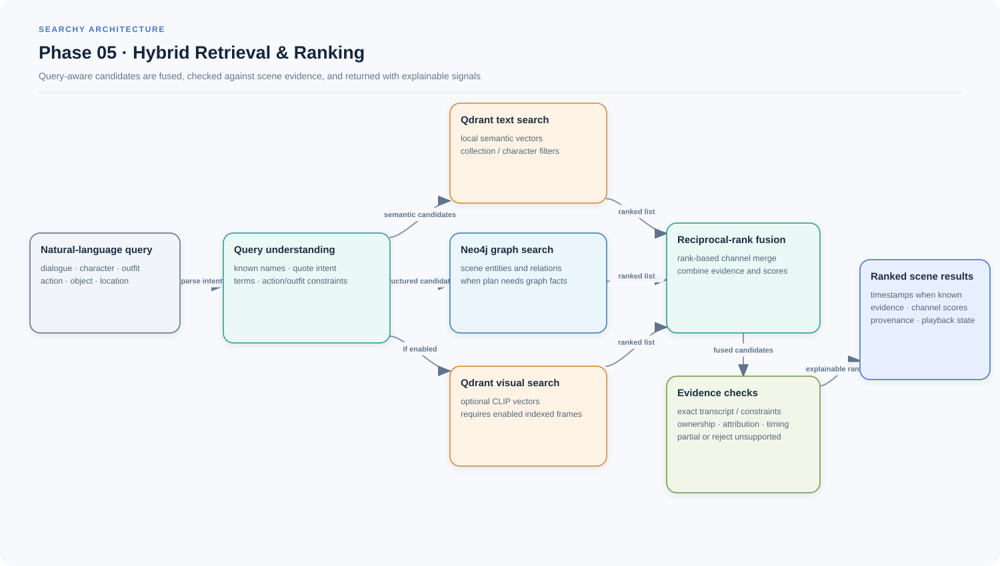
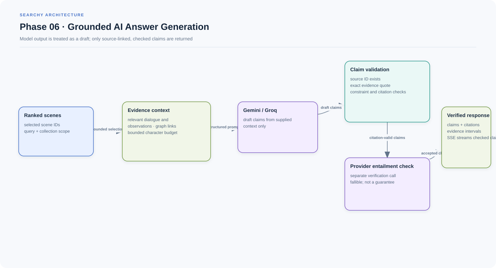
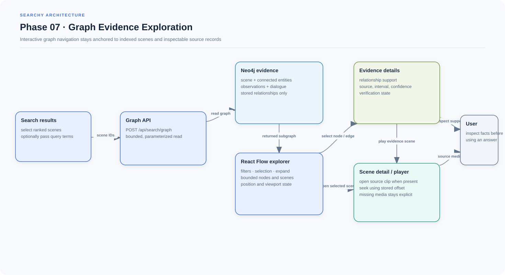
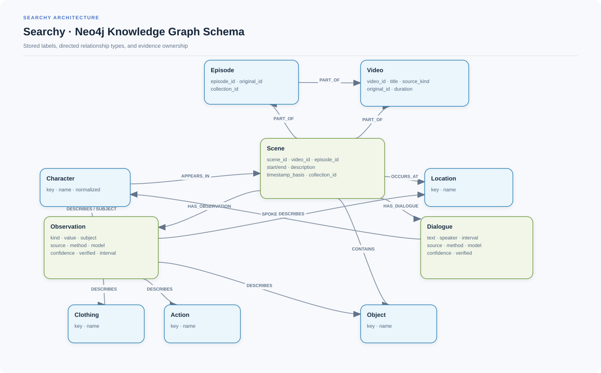

<p align="center">
  
</p>

<p align="center">
  
  
  
  
  
  
</p>

<h1 align="center">Searchy</h1>

<p align="center">Search video collections at scene level with natural language. Searchy combines computer vision and speech transcription with a scene-scoped Neo4j knowledge graph, Qdrant vector retrieval, and evidence-grounded GraphRAG answers.</p>

## Languages & Frameworks

The stack below reflects the checked-in Python project, frontend manifests, and Compose configuration.

| Category | Technologies |
| --- | --- |
| **Languages** | Python 3.12, TypeScript, CSS |
| **Backend frameworks** | FastAPI, Pydantic v2, Uvicorn |
| **Frontend frameworks** | React 19, Vite 7, React Router, TanStack Query, Tailwind CSS 4 |
| **AI & computer vision** | faster-whisper, PySceneDetect, FFmpeg/FFprobe, sentence-transformers, EmbeddingGemma, configurable CLIP image embeddings, optional OpenCV YuNet/SFace reference matching |
| **Knowledge graph** | Neo4j Community Edition, Cypher |
| **Vector search** | Qdrant; local sentence-transformers text vectors and optional CLIP visual vectors |
| **LLM & orchestration** | Gemini and Groq provider adapters over HTTPX; deterministic query understanding and evidence validation |
| **Infrastructure** | uv, Docker Compose, SQLite for metadata/jobs/search sessions |

## Key Features

- Search dialogue, characters, clothing, actions, objects, locations, and general scene descriptions.
- Import processed scene chunks and their captions, dialogue, timestamps, and available media, or queue a new video for shot detection, transcription, frame sampling, and visual analysis.
- Keep imported observations, generated descriptions, dialogue, and media provenance associated with their source and scene interval.
- Combine semantic Qdrant search with scene-scoped Neo4j retrieval and optional visual similarity. Search applies reciprocal-rank fusion, then deterministic checks for character, dialogue, clothing ownership, and timing constraints.
- Explore the evidence behind a result in a bounded graph view; request a grounded answer with source-linked claims and citations.
- Upload character references, queue recognition, inspect candidate frames, and accept or reject proposed matches. Uncertain identities stay unidentified or unverified.
- Use a responsive React interface for the dashboard, library, search, scene player, characters, and processing jobs.
- Report metadata-only results when source media is missing. Searchy never synthesizes a playable clip or invents a timestamp.

## System Architecture & Workflow

### Overall architecture

Both ingestion modes produce the same validated `Video`, `Scene`, `Dialogue`, `Observation`, and provenance records. SQLite stores local metadata, job state, and search sessions; Neo4j stores graph relationships; Qdrant stores named text and optional image vectors. FastAPI coordinates ingestion and retrieval for the React application.

<p align="center"></p>

[Open the editable Draw.io source](docs/architecture/searchy-overall-architecture.drawio)

### Detailed phase diagrams

#### Phase 01 — Video ingestion and normalization

Existing processed chunks are inspected and imported as they are; uploaded videos are validated and added to the persistent local job queue. Both paths normalize into the same scene records while preserving source identifiers, available time offsets, and provenance. Importing metadata does not create missing media.

<p align="center"></p>

[Editable Draw.io source](docs/architecture/01-video-ingestion-preprocessing.drawio)

#### Phase 02 — Audio, scene, and visual processing

For uploaded videos, FFprobe validates streams and duration, PySceneDetect supplies shot boundaries, FFmpeg samples a small number of representative frames per scene, and faster-whisper produces word-timed dialogue when audio exists. A configured Gemini or Groq vision provider analyzes the sampled frames and scoped character references. Hash/model/settings fingerprints allow successful work to be reused. VLM observations cite sampled frames; they are not frame-by-frame annotations.

<p align="center"></p>

[Editable Draw.io source](docs/architecture/02-audio-scene-visual-processing.drawio)

#### Phase 03 — Scene-scoped knowledge graph

Neo4j upserts videos, optional episode records, scenes, dialogue, observations, and typed entities using stable identifiers and uniqueness constraints. A clothing or action observation links to its subject and evidence rather than asserting an unsupported global character fact. Scene observations retain their own timestamps and provenance.

<p align="center"></p>

[Editable Draw.io source](docs/architecture/03-scene-knowledge-graph.drawio)

#### Phase 04 — Text and optional visual vector indexing

Search text combines the scene description, observations, and dialogue. The configured local sentence-transformers model embeds that text into a named Qdrant vector. When `VISUAL_ENABLED=true`, sampled frames and text queries also use the configured CLIP-compatible model and a separate named vector. Searchy checks existing collection dimensions and vector configuration before indexing.

<p align="center"></p>

[Editable Draw.io source](docs/architecture/04-vector-indexing.drawio)

#### Phase 05 — Hybrid retrieval and ranking

Query understanding extracts known character names, dialogue intent, clothing terms, actions, and other constraints. Depending on the request, Searchy queries Qdrant text vectors, graph matches in Neo4j, and optional visual vectors. Reciprocal-rank fusion combines channel candidates; deterministic scene checks then reject unsupported constraints or mark results partial and return supporting evidence, channel scores, provenance, and playback availability. Scores are ranking signals, not probabilities.

<p align="center"></p>

[Editable Draw.io source](docs/architecture/05-hybrid-retrieval.drawio)

#### Phase 06 — Grounded AI answer generation

The answer service selects a bounded set of ranked scenes and relevant dialogue, observations, and graph links. A Gemini or Groq provider drafts claims from that context; Searchy checks each published claim against stored source evidence and asks a separate provider check to assess entailment. Citations use indexed evidence identifiers and intervals. Streaming emits completed verified claims; model checks reduce risk but do not replace reviewing the source video.

<p align="center"></p>

[Editable Draw.io source](docs/architecture/06-grounded-answer-generation.drawio)

#### Phase 07 — Graph evidence exploration

The graph endpoint returns a bounded, query-relevant subgraph for selected scenes. The frontend can expand a scene to its stored observations and dialogue, inspect relationship support, filter and navigate the graph, and open the source scene in the player. Expansion reveals indexed evidence; it does not generate or write new graph facts.

<p align="center"></p>

[Editable Draw.io source](docs/architecture/07-graph-evidence-exploration.drawio)

## Knowledge Graph Schema

Neo4j uses uniqueness constraints on IDs for videos, episodes, scenes, observations, dialogue, and typed entities. `Episode` is optional when an imported record has episode metadata; scenes always link directly to their source `Video`. Relationships below are the stored schema, not inferred shortcuts.

<p align="center"></p>

[Editable Draw.io source](docs/architecture/08-searchy-knowledge-graph-schema.drawio)

Important association rules:

- `(Scene)-[:HAS_OBSERVATION]->(Observation)` and `(Scene)-[:HAS_DIALOGUE]->(Dialogue)` keep evidence local to its scene.
- `(Observation)-[:SUBJECT]->(Character)` identifies the attributed subject when supported; `(Observation)-[:DESCRIBES]->(Clothing|Action|Object|Location|Character)` records the evidence described.
- `(Character)-[:APPEARS_IN]->(Scene)` represents scene appearance; `(Dialogue)-[:SPOKEN_BY]->(Character)` is used only where speaker attribution exists.
- `(Scene)-[:CONTAINS]->(Object)` and `(Scene)-[:OCCURS_AT]->(Location)` represent the stored scene associations.
- `PART_OF` links a scene to its video and, when known, its episode; an episode links to its video.
- Observations and dialogue retain source, method, model, confidence, verification state, and available time interval. Co-occurrence alone does not establish who wore an item or spoke a line.

## Hybrid GraphRAG Retrieval

The retrieval path keeps candidate generation separate from answer generation:

1. **Understand the request.** Normalize query terms and identify known characters, literal quotes, outfit descriptions, action intent, and graph-relevant constraints.
2. **Gather scene candidates.** Query Qdrant for semantic text vectors, query Neo4j for graph matches when the plan needs structured facts, and query visual vectors only when visual search is enabled. Literal dialogue can be checked against stored transcript text.
3. **Fuse and validate.** Reciprocal-rank fusion combines returned channels. Deterministic checks verify collection and character filters, exact quoted phrases, speaker attribution, clothing ownership, and temporal overlap. Candidates with missing evidence are marked partial or filtered.
4. **Return explainable scenes.** Results include scene/video/episode IDs, available timestamps, matching characters, dialogue, source evidence, channel scores, provenance, and media availability. Missing media remains unavailable.
5. **Optionally answer from evidence.** The answer API receives bounded indexed context, validates claim citations against stored evidence, and returns only verified claims with source references.

The first implementation uses deterministic query parsing and checks; it does not include a learned cross-encoder reranker. Literal constraint checks favor precision and may miss paraphrases. An LLM explanation is a separate operation and cannot create indexed scenes or timestamps.

## Installation & Setup

### Requirements

- Python 3.12 and [uv](https://docs.astral.sh/uv/)
- Docker Compose (Docker Desktop on Windows) for Neo4j and Qdrant
- Node.js and npm for the React frontend
- FFmpeg and FFprobe for uploaded-video processing
- API access for the selected Gemini or Groq vision/answer provider

### Configure the backend

From the repository root:

```powershell
uv sync --extra models --extra video
Copy-Item .env.example .env
```

Set a local `NEO4J_PASSWORD` in `.env`, then add `GEMINI_API_KEY` or `GROQ_API_KEY` for the selected provider. `.env.example` contains empty key fields; never commit `.env`. The example defaults to Google GenAI, local `google/embeddinggemma-300m` text embeddings, CPU Whisper, and disabled visual-vector search. Model access can require accepting the model's Hugging Face terms and configuring `HF_TOKEN`.

Ensure `FFMPEG_PATH` and `FFPROBE_PATH` resolve to the installed executables. Keep all credentials, model caches, local databases, and media files out of Git.

### Start databases and services

```powershell
docker compose up -d
uv run --extra models --extra video uvicorn searchy.main:app --reload
```

The API is available at `http://127.0.0.1:8000`; interactive OpenAPI docs are at `/docs`. FastAPI starts the local persistent job worker when `WORKER_ENABLED=true`. Readiness checks Neo4j and Qdrant and validates any existing Qdrant vector configuration. The first model use may download weights and take time.

### Import the provided collection

Processed data is expected under `data/episodes_splitted` and character reference metadata under `data/meta`, as configured in `.env.example`. Inspect and enqueue an import:

```powershell
Invoke-RestMethod http://127.0.0.1:8000/api/imports/inspect
$job = Invoke-RestMethod -Method Post http://127.0.0.1:8000/api/imports -ContentType application/json -Body '{"collection_id":"friends"}'
Invoke-RestMethod "http://127.0.0.1:8000/api/jobs/$($job.job_id)"
```

The local inspected dataset has 24 Friends season-one episodes, 550 captioned chunks with MP4 files, 9,199 subtitle records, and six character-reference PNGs. It does not contain complete season episodes or standalone SRT/VTT files. Files copied under `data/` are local assets and excluded from Git. Playback is available only for scene media that exists and is referenced by the imported records; inspect the API's `playback.available` value.

### Start the frontend

In a second terminal:

```powershell
cd frontend
npm ci
npm run dev
```

Open `http://127.0.0.1:5173`. Vite proxies `/api`, `/health`, and `/ready` to the local FastAPI server. To build and type-check the production frontend, run `npm run build`.

## Project Structure

```text
src/searchy/
  api/          FastAPI routes and Pydantic contracts
  core/         Settings, errors, and shared configuration
  graph/        Neo4j scene graph and bounded exploration
  ingestion/    Existing processed-chunk importer
  models/       Text/visual embeddings and Gemini/Groq adapters
  processing/   FFprobe, shot detection, Whisper, frame sampling
  retrieval/    Query understanding, candidate fusion, evidence checks
  services/     Search, answers, catalog, media, and recognition orchestration
  storage/      SQLite metadata/jobs/sessions and Qdrant vectors
  worker.py     Persistent local background job worker
frontend/src/
  app/          Routing and workspace shell
  features/     Search, graph, library, player, characters, jobs
  components/   Shared interface components
  services/     Typed API client and server-state queries
docs/architecture/
  *.drawio      Editable Draw.io sources
  *.svg         Matching vector exports embedded below
```

## Example Usage

### Search scenes

```bash
curl -X POST http://127.0.0.1:8000/api/search \
  -H "Content-Type: application/json" \
  -d '{"query":"Phoebe playing guitar","limit":5,"mode":"hybrid"}'
```

The response includes ranked scene results, matching channels, evidence, provenance, timestamps when known, and playback availability. Supported modes are `hybrid`, `text`, `graph`, and `visual`; visual mode requires `VISUAL_ENABLED=true` and scenes indexed with frames.

### Upload a video and poll its job

```bash
curl -F "file=@/path/to/video.mp4" \
  -F "collection_id=uploads" \
  http://127.0.0.1:8000/api/videos/upload
curl http://127.0.0.1:8000/api/jobs/<job_id>
```

Upload acceptance means the file was queued, not that indexing is complete. Jobs report `queued`, `running`, `completed`, or `failed`, with stage and progress information. Retry a failed job with `POST /api/jobs/{job_id}/retry`.

### Request a grounded answer

```bash
curl -X POST http://127.0.0.1:8000/api/search/answer \
  -H "Content-Type: application/json" \
  -d '{"query":"What evidence shows Phoebe playing guitar?","scene_ids":["<scene-id>"]}'
```

The answer stream is available at `POST /api/search/answer/stream`. Search context without answer generation is available from `POST /api/search/context`; bounded scene graph data can be requested with `POST /api/search/graph`.

Other useful endpoints include `GET /health`, `GET /ready`, `GET /api/workspace`, `GET /api/library`, `GET /api/videos`, `GET /api/jobs`, `GET /api/scenes/{scene_id}`, `GET /api/scenes/{scene_id}/media`, and `GET /api/scenes/{scene_id}/subtitles.vtt`. Upload, job, character, collection, scene, and search contracts are documented in `/docs`.
