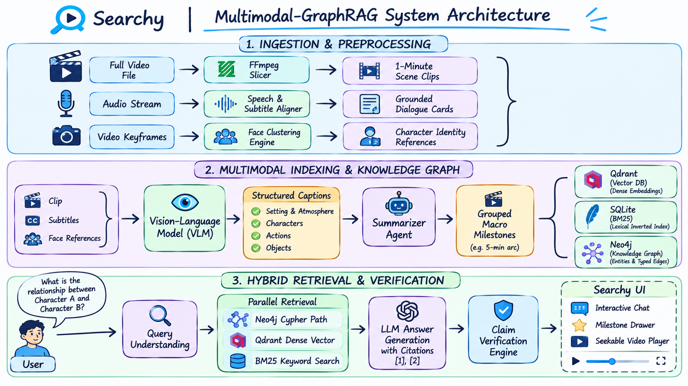
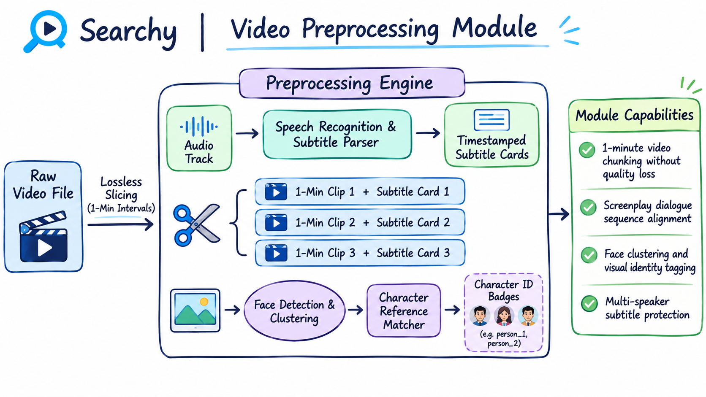
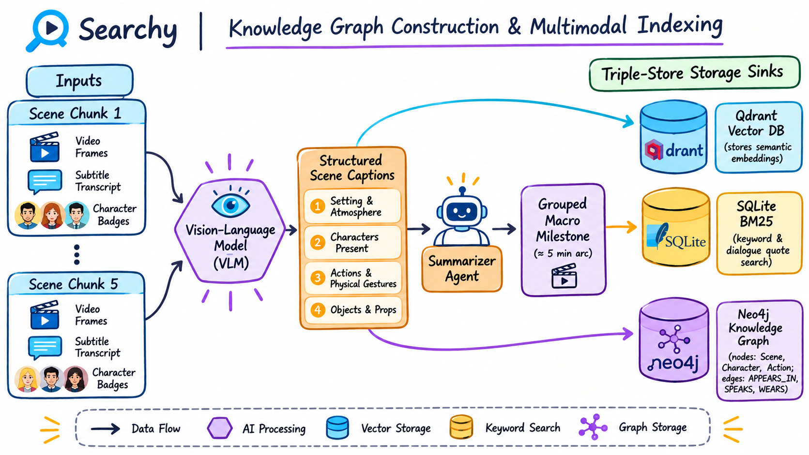
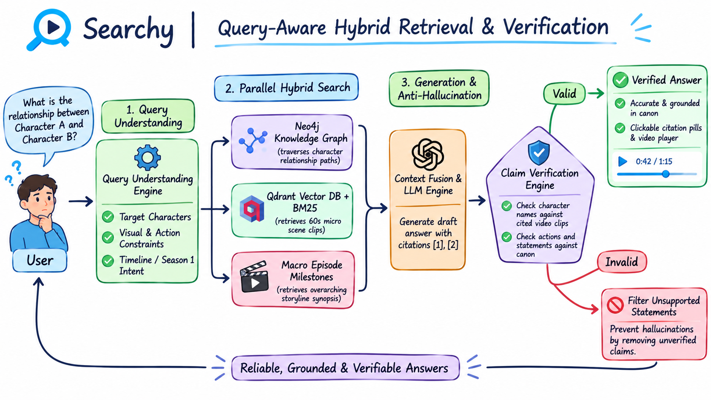

<div align="center">


# Searchy
### Multimodal GraphRAG Video Analysis & Grounded Knowledge Retrieval

[](https://www.python.org/)
[](https://www.typescriptlang.org/)
[](https://fastapi.tiangolo.com/)
[](https://react.dev/)
[](https://neo4j.com/)
[](https://qdrant.tech/)
[](https://sqlite.org/)

</div>

---

**Searchy** is a multimodal video search engine built on top of Vision-Language Models, Neo4j, and Qdrant. It lets you query long-form video using natural language, returning exact video moments, character relationships, and grounded summaries backed by interactive video timestamps.

## Demo

[▶ Watch Searchy Demo](https://github.com/user-attachments/assets/02acaae1-fc4b-4727-b5c5-54ff3c43043b)

---

### Languages & Tech Stack

- **Languages**:
  - **Python 3.12**: Backend API, VLM grounding pipeline, hybrid retrieval algorithms, and video processing.
  - **TypeScript**: Frontend web app, interactive video player, sidebar inspector, and chat UI.
  - **Cypher (CQL)**: Graph traversals and character relationship queries in Neo4j.
  - **SQL**: Metadata storage, episode summaries, and BM25 lexical indexing in SQLite.
- **Frameworks & Databases**:
  - **Backend**: FastAPI, Uvicorn, Pydantic v2
  - **Frontend**: React 18, Vite, Tailwind CSS, Lucide Icons
  - **Databases**: Neo4j (Knowledge Graph), Qdrant (Dense Vector DB), SQLite (Metadata & BM25)
  - **Video**: FFmpeg (stream-copy splitting and keyframe sampling)

---

## Installation & Setup

### Prerequisites

- Python 3.12+
- Node.js 18+ & npm
- Docker & Docker Compose
- FFmpeg

### Python Packages

We use `uv` for lightning-fast dependency management, but you can also use `pip`.

```bash
# Backend installation
uv sync

# Frontend installation
cd frontend
npm install
cd ..
```

### Docker Services

The system relies on **Neo4j** for the Knowledge Graph and **Qdrant** for the Vector Database.

```bash
docker-compose up -d
```

This will start:

- **Neo4j**: Accessible at `http://localhost:7474` (Bolt: `7687`)
- **Qdrant**: Accessible at `http://localhost:6333` (Dashboard: `http://localhost:6333/dashboard`)

### Environment Variables

Create a `.env` file based on `.env.example`:

```env
COLLECTION_ID=friends
DATABASE_PATH=var/searchy.sqlite3

# Vector Database (Qdrant)
QDRANT_URL=http://127.0.0.1:6333
QDRANT_COLLECTION_NAME=searchy_scenes
EMBEDDING_PROVIDER=local
EMBEDDING_MODEL_ID=nomic-ai/nomic-embed-text-v1.5

# Knowledge Graph (Neo4j)
NEO4J_URI=bolt://127.0.0.1:7687
NEO4J_USER=neo4j
NEO4J_PASSWORD=searchy_secret
NEO4J_DATABASE=neo4j

# Vision & Language Model Providers
VLM_PROVIDER=gemini
GEMINI_API_KEY=your_gemini_api_key

ANSWER_PROVIDER=nim
NIM_API_KEY=your_nvidia_nim_api_key
NIM_MODEL_ID=nvidia/nemotron-3.5-bolt-e4b
```

---

## Running the Application

### 1. Start Backend Server

```bash
uvicorn searchy.main:create_app --factory --host 127.0.0.1 --port 8000
```

Interactive API documentation will be available at `http://127.0.0.1:8000/docs`.

### 2. Start Frontend UI

```bash
cd frontend
npm run dev
```

Open `http://127.0.0.1:5173` in your browser.

---

## Project Structure

```text
Searchy/
├── data/
│   ├── meta/                       # Character reference images for VLM grounding
│   └── episodes_splitted/          # 60s video chunks, subtitles, and captions
├── frontend/                       # Interactive React + TypeScript user interface
│   ├── src/
│   │   ├── components/             # RichText, VideoPlayer, Sidebar panels
│   │   ├── pages/                  # ChatPage, ScenePage, CharactersPage
│   │   └── styles/                 # Application styling
├── src/searchy/                    # Core Python application package
│   ├── api/                        # FastAPI route controllers and schemas
│   ├── core/                       # Settings, environment, and error handling
│   ├── domain.py                   # Domain models (Scene, Video, Observation)
│   ├── graph/                      # Neo4j GraphStore and GraphExplorer
│   ├── ingestion/                  # Screenplay sequence aligner and chunk importer
│   ├── models/                     # AI providers (VLM, Embeddings, ClaimVerifier)
│   ├── processing/                 # Video splitting, metadata extraction, captioning
│   ├── retrieval/                  # Hybrid SearchEngine, BM25 Index, QueryUnderstanding
│   ├── services/                   # Business orchestration and chat services
│   ├── storage/                    # SQLite MetadataStore and Qdrant VectorStore
│   └── summaries/                  # Canonical episode milestones and grounding builder
├── docs/                           # Architecture diagrams and documentation
├── docker-compose.yml              # Neo4j and Qdrant container orchestration
└── pyproject.toml                  # Project configuration and dependencies
```

---

## System Architecture & Workflow

Searchy converts full-length video into a structured, searchable knowledge graph. The system is designed to solve a fundamental problem in video retrieval: video frames, dialogue lines, and visual actions are completely disconnected in raw video files. By processing video across four connected stages, Searchy grounds visual appearances to verified character identities and organizes everything into a queryable graph.



The overall pipeline shown above handles video data in four phases:

1. **Preprocessing & Alignment**: Raw video is split into 1-minute chunks, subtitles are synchronized with audio timestamps, and faces are clustered across keyframes.
2. **Grounded Captioning**: A Vision-Language Model watches each 1-minute clip alongside reference portraits to generate accurate visual observations.
3. **Graph & Storage Indexing**: Extracted metadata is mapped into a Neo4j Knowledge Graph, grouped into 5-minute story milestones, and indexed into Qdrant (vectors) and SQLite (BM25).
4. **Hybrid Retrieval & Verification**: User queries are resolved across graph traversals, dense vectors, and milestone summaries, fact-checked by a verification engine, and displayed in an interactive video player.

---

### 1. Video Preprocessing & Alignment

Before an AI model can analyze long video content, the media must be broken down into manageable, synchronized units. Processing an entire 30-minute episode in a single prompt exceeds context windows and leads to temporal confusion. Searchy breaks videos into standardized 1-minute intervals while aligning dialogue and facial features.



#### Video Splitting and Audio Transcription

Full-length episodes are cut into clean 60-second clips using FFmpeg stream copy mode (`-c copy`). Because stream-copy avoids re-encoding the video stream, an entire 25-minute episode is split in under five seconds with zero degradation in visual quality.

Each 1-minute video chunk is matched with its corresponding subtitle dialogue from VTT or SRT files based on playback timestamps. When existing subtitle files are missing or incomplete, the system automatically falls back to an Automatic Speech Recognition (ASR) model like Whisper to generate timestamped audio transcriptions.

#### Face Clustering and Character Identification

Knowing which characters appear in each shot is critical for accurate retrieval. The preprocessing engine samples keyframes across each 1-minute clip, detects human faces, and computes facial feature embeddings. 

These facial embeddings are clustered into distinct identities and matched against known reference images (stored in `data/meta/`). Each clip is then tagged with verified character IDs, establishing ground-truth visual identities before any language model sees the footage.

#### Screenplay Sequence Alignment

Dialogue transcripts alone often lack speaker labels. Searchy aligns raw subtitle lines with official screenplays using monotonic sequence matching. This accurately assigns verified character names to spoken utterances while safely preserving ambiguous or off-camera background lines as unassigned rather than making false guesses.

---

### 2. VLM Grounded Captioning

Once 1-minute clips are prepared, a Vision-Language Model (VLM) analyzes the visual content. Standard vision models frequently hallucinate character identities—confusing similar-looking actors, mistaking background extras for main characters, or inventing names that don't exist in the series.

Searchy solves this by injecting verified reference portraits of known characters into the vision prompt alongside the video frames. The model is explicitly instructed to ground its descriptions only in these verified identities.

#### Four Structured Observation Channels

For every 1-minute clip, the VLM produces a structured four-part analysis:

- **Scene Setting**: Identifies the physical environment, architectural style, lighting conditions, and time of day (e.g. *Central Perk seating area, warm indoor lighting, afternoon*).
- **Characters Present**: Lists only the verified characters visually confirmed on screen during the interval.
- **Actions & Body Language**: Details physical movements, entrances, exits, gestures, and character-to-character physical interactions.
- **Objects & Props**: Catalogs wardrobe choices, handheld items, clothing colors, and key background props.

This structured breakdown ensures that visual queries (such as *"Monica wearing a red apron"* or *"Chandler holding a coffee cup"*) can be matched directly against specific visual fields.

---

### 3. Knowledge Graph & Storage Indexing

Unstructured captions and dialogue lines must be organized into databases optimized for both deep relationship queries and fast semantic search. Searchy indexes every episode across three complementary storage systems.



#### Knowledge Graph Construction in Neo4j

The system extracts structured entities from scene observations and builds a rich property graph in Neo4j:

- **Graph Nodes**: `Character`, `Scene`, `Action`, `Observation`, `Episode`, `Clothing`, and `Object`.
- **Directional Edges**: `APPEARS_IN`, `SPEAKS`, `WEARS`, `INTERACTS_WITH`, and `LOCATED_AT`.

This graph structure allows the system to traverse multi-hop connections that vector databases cannot resolve on their own, such as answering *"Who was in the room when Paul first showed up?"* or *"Which scenes feature both Ross and Rachel in Monica's apartment?"*.

#### The Summarizer Agent: 5-Minute Macro Milestones

While 1-minute clips provide micro-level precision, they cannot answer high-level questions about broader plotlines or multi-scene relationship arcs. 

The Summarizer Agent solves this by aggregating sequential 1-minute chunks into chronological **~5-minute narrative milestones**. Rather than relying on an unconstrained LLM that might drift across seasons, the agent computes an objective alignment score between scene evidence and canonical milestones:

$$\text{Score} = (4 \times \text{Dialogue Matches}) + (2 \times \text{Visual Matches}) + (1 \times \text{Character Presence})$$

Each milestone binds to exact start/end timecodes and supporting scene IDs. When a user asks about a general storyline, the system surfaces the milestone summary and immediately links to the underlying video scenes.

#### Dual Vector and Lexical Storage Sinks

To balance fuzzy conceptual search with exact keyword lookups, Searchy maintains two specialized search indexes:

- **Qdrant Vector Database**: Stores dense semantic vector embeddings in two collections—`searchy_scenes` for individual 1-minute visual descriptions, and `searchy_episodes` for 5-minute macro milestone summaries.
- **SQLite (BM25 Index)**: Provides an inverted lexical index for instantaneous exact-match lookups across spoken dialogue lines, character names, and costume colors.

---

### 4. Hybrid Retrieval & Factual Verification

When a user submits a question through the chat interface, Searchy executes a multi-stage retrieval pipeline designed to prevent hallucinations and ground every answer in verifiable video timestamps.



#### Query Understanding and Routing

The retrieval engine first analyzes the user's natural language prompt. It identifies whether the question requires:
- Specific dialogue quote matching (routed to SQLite BM25).
- Visual scene or atmosphere lookups (routed to Qdrant scene vectors).
- Multi-hop character interactions (routed to Neo4j Cypher queries).
- Broad episode storyline context (routed to Qdrant milestone summaries).

#### Triad Retrieval Fusion

The system retrieves candidate scenes from Neo4j, Qdrant, and SQLite in parallel. The results from vector search and lexical search are merged using **Reciprocal Rank Fusion (RRF)**, which balances semantic relevance with exact keyword hits. The top matching milestone summaries are then prepended to give the LLM narrative context.

#### Claim Verifier Guardrail

Before an answer is shown to the user, an anti-hallucination verification engine analyzes the generated response sentence-by-sentence. Each claim is tested against the retrieved dialogue transcripts and scene captions:

- Claims backed by explicit video evidence are validated and given citation markers (e.g. `[1]`, `[2]`).
- Any claim that cannot be proven by the retrieved clips is automatically dropped.
- If the indexed evidence is insufficient to answer the question, the system clearly states that evidence is not available rather than guessing.

#### Interactive Playback UI

The response streams to the user interface alongside interactive source citation cards. Clicking any citation opens the integrated video player, jumps directly to the exact second where the event occurred, and highlights the corresponding dialogue subtitle.
